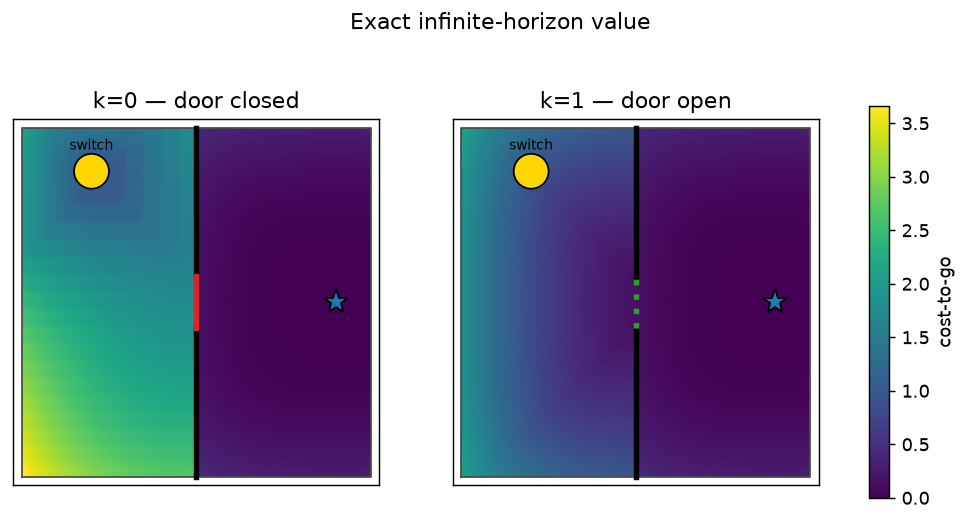
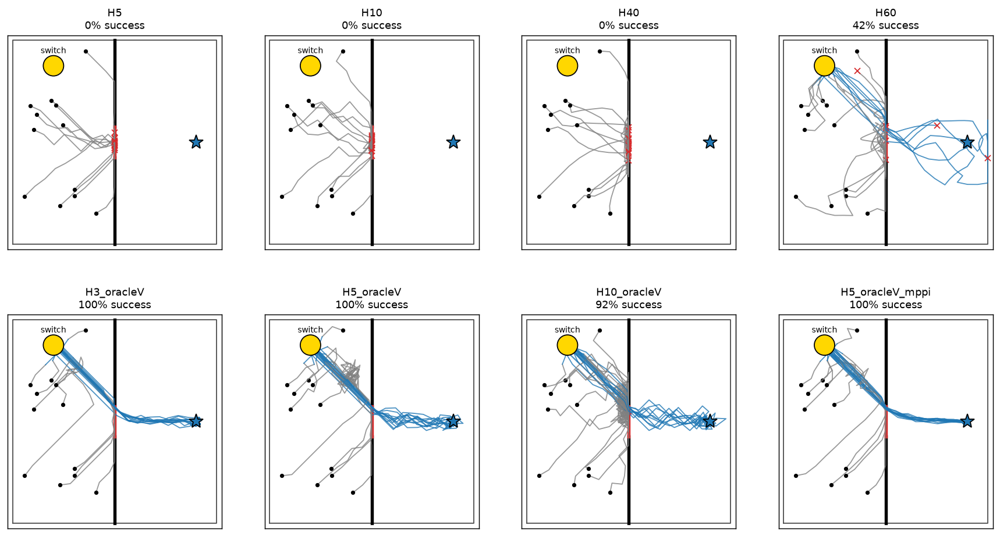
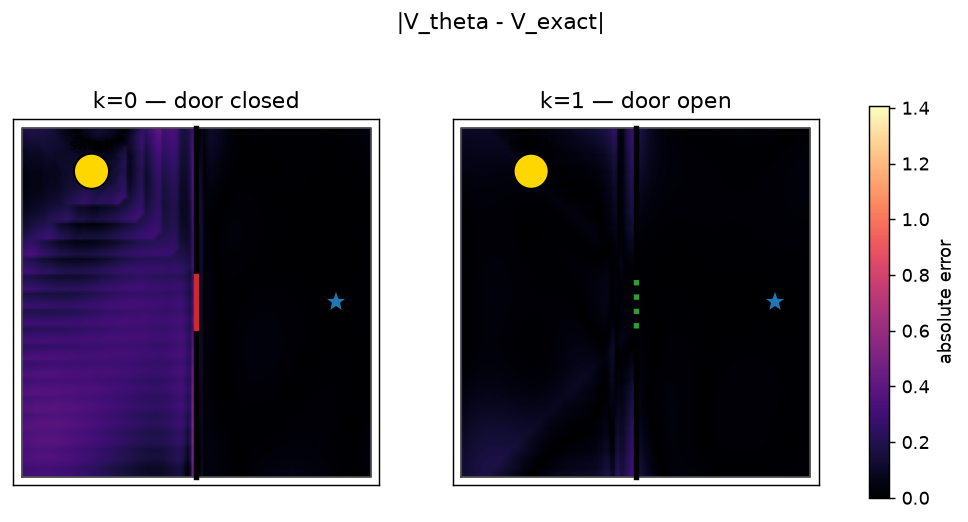
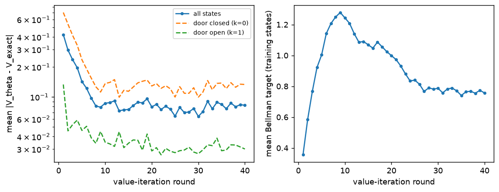
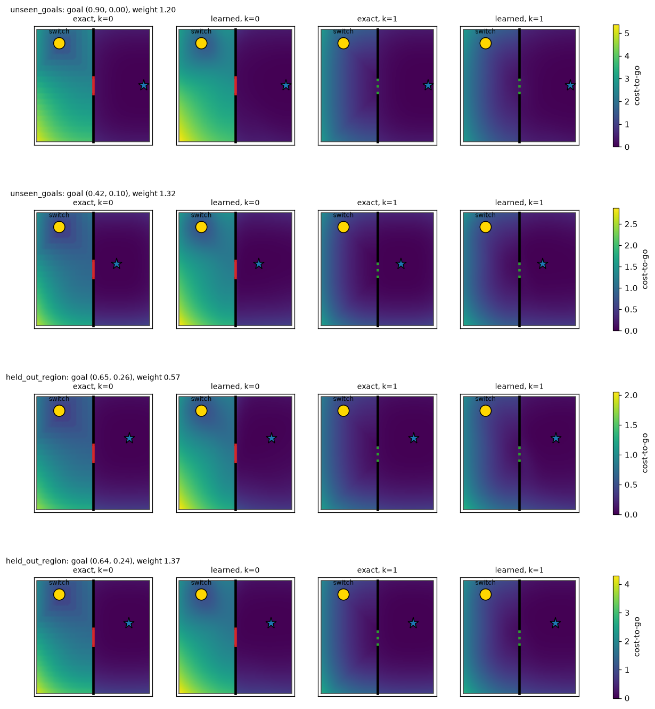
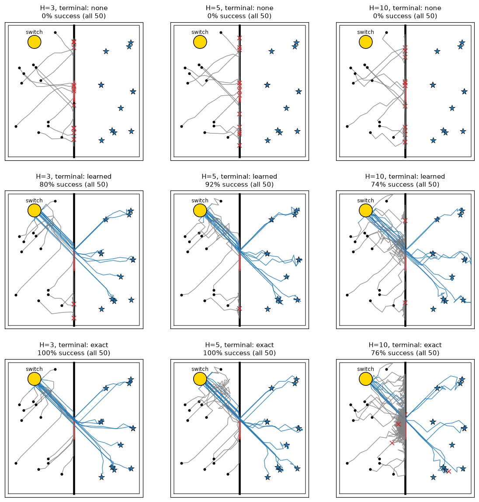
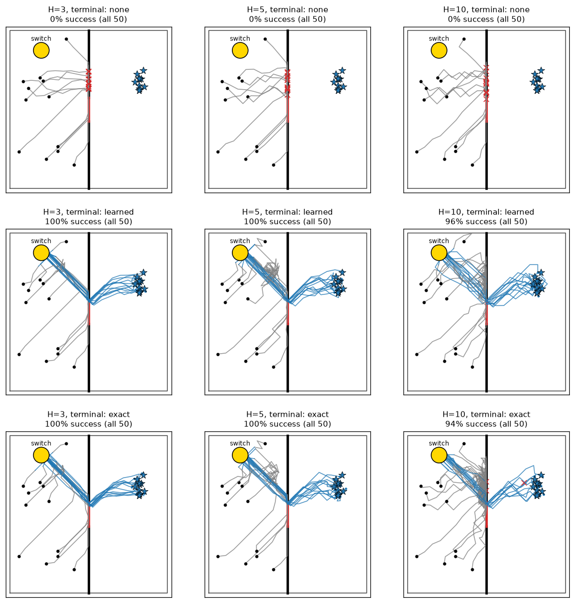
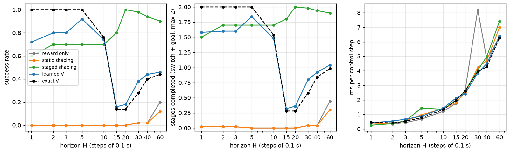
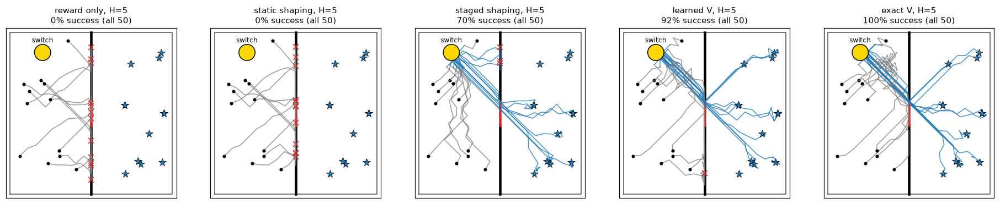

# Language to Rewards with a Learned Value Function

[](https://github.com/scxue001/l2r-value-mpc/actions/workflows/ci.yml)

ROB-GY 6323 project: short-horizon MPC for multi-stage manipulation.

* An LLM writes the parameters ψ of an L2R-style reward.
* A sampling MPC optimises that reward.
* A learned terminal value V_θ(x; ψ) lets the MPC solve multi-stage tasks with a short horizon.

This repository contains the toy problem (key and door) and the shared code that the arm tasks will build on.

## What has been done

* **Reward API** in the style of Language to Rewards. A reward is a list of named residual terms (`PositionTarget`, `Distance`, `ControlEffort`). The flat vector ψ = [weight, params] per term is both what the LLM will write and what V_θ is conditioned on.
* **Batched sampling MPC.** It solves many independent problems at once, with an optional terminal cost. It supports spline knots and two update rules: the MPPI weighted average, and best-sample (MJPC Predictive Sampling, the planner L2R uses). The same function is the real-time controller and the value-iteration target solver.
* **Key-door toy environment**, batched in PyTorch, with an **exact grid value** used as ground truth and as an "oracle" terminal cost.
* **Fitted value iteration** (eq. 2 of the proposal). Targets come from a short sampling MPC with the previous value as terminal cost. Training follows Jordana et al.: V = ½‖r_θ‖², tanh layers, and an anchor term at the goal. Two additions make it work here: on-policy states and a replay buffer (see below).
* **Goal-conditioned value.** One network V_θ(x; ψ) is trained on random goals and goal weights, then tested on unseen goals and on a region of goals it never saw during training.
* **Controller comparison and horizon sweep.** The proposal's controllers are compared at horizons 1–60 with the same samples per step:
  * reward only;
  * reward + hand-written shaping, in two forms;
  * reward + learned value;
  * reward + exact value.
* **Evaluation:** closed-loop success, stages completed, steps, cost and time per step, plus value error against the exact solution.
* **Tests:** 24 unit tests covering the reward API, MPC, environment, shaping, exact value, value iteration and headless imports. They run on every pull request (see [Continuous integration](#continuous-integration)).

## Toy problem

| Item | Definition |
|---|---|
| Room | [-1, 1]² |
| Wall | x = 0, with a door gap \|y\| < 0.15 that stays closed until the point has touched the switch at (-0.6, 0.75) |
| State | (pₓ, p_y, k), with k = 1 once the switch has been pressed |
| Dynamics | single integrator, \|u\|∞ ≤ 1, dt = 0.1 s |
| Reward | goal distance (weight 1) + control effort (weight 0.01); **no term mentions the switch** |
| Evaluation | 50 episodes from random starts left of the wall, at most 150 steps (15 s) |
| Sampler | every controller uses 256 samples and 1 iteration per control step, σ = 1, best-sample update |

Timings are from an Apple M4 CPU with one episode at a time.

### 1. Without a value function the task needs a long horizon

The exact value (left: door closed, right: door open). With the door closed, the cost-to-go correctly falls towards the switch, and it jumps sharply across the wall.



Even an exact optimiser needs a horizon of 30 steps (3 s) when there is no terminal value. This is an exact H-step lookahead on the grid:

| horizon H | 5 | 10 | 15 | 20 | 25 | 30 | 40 | 60 |
|---|---|---|---|---|---|---|---|---|
| success | 0.00 | 0.00 | 0.12 | 0.26 | 0.48 | **1.00** | 1.00 | 1.00 |

Sampling MPC is worse still. Random samples rarely find the small switch, so long horizons barely help. The table uses random starts and random goals.

| controller | success | ms / step |
|---|---|---|
| H = 5, no terminal value | 0.00 | 0.8 |
| H = 10, no terminal value | 0.00 | 1.2 |
| H = 40 (8 knots), no terminal value | 0.04 | 4.3 |
| H = 60 (12 knots), no terminal value | 0.20 | 6.4 |
| H = 3, exact value | **1.00** | 0.6 |
| H = 5, exact value | 1.00 | 0.8 |
| H = 10, exact value | 0.72 | 1.4 |

Even with 2048 samples × 3 iterations per step (24× the compute), H = 60 only reaches 42%.



### 2. Learned value for one goal: matches the exact value in closed loop

Training settings:
* 40 rounds of value iteration with 4096 states per round.
* Targets from a 5-step sampling MPC (256 samples, 3 iterations).
* MLP with 3 × 64 tanh layers and output V = ½‖r‖², r ∈ ℝ³².
* Training takes about 2 minutes on CPU.

The goal is fixed to (0.8, 0).

**Value error** on 4000 held-out states (mean exact value 0.80):

| | all states | door closed (k = 0) | door open (k = 1) |
|---|---|---|---|
| mean absolute error | 0.083 | 0.133 | 0.030 |

**Closed loop**, 50 random starts:

| horizon | terminal value | success | steps to goal | episode cost | ms / step |
|---|---|---|---|---|---|
| 3 | none | 0.00 | – | 10.01 | 0.5 |
| 3 | **learned** | **1.00** | 23.8 | 2.27 | 0.8 |
| 3 | exact | 1.00 | 23.4 | 2.22 | 0.6 |
| 5 | none | 0.00 | – | 10.06 | 0.8 |
| 5 | **learned** | **1.00** | 29.3 | 2.87 | 1.2 |
| 5 | exact | 1.00 | 30.7 | 3.08 | 1.1 |
| 10 | none | 0.00 | – | 10.16 | 1.4 |
| 10 | **learned** | **1.00** | 39.9 | 3.53 | 2.2 |
| 10 | exact | 0.86 | 64.4 | 6.11 | 2.3 |

A 3-step MPC with the learned value solves the task. It needs about 0.8 ms per step, while a 60-step MPC without it fails 80% of the time at 6.4 ms per step.

The learned value is smoother than the grid value, which makes the 10-step sampling problem easier. That is why it beats the exact value at H = 10.

| learned value | absolute error |
|---|---|
|  |  |




### 3. One value for every goal (conditioned on ψ)

ψ = (goal weight, goal position, effort weight) is sampled anew for every training state:
* goal position uniform in x ∈ [0.4, 0.9], y ∈ [-0.8, 0.8];
* goal weight uniform in [0.5, 2.0];
* effort weight fixed at 0.01.

A **held-out box** of goals, x ∈ [0.55, 0.75] × y ∈ [0.2, 0.5], is never used in training.

Training uses the same algorithm with:
* 100 rounds of 8192 states;
* a 3 × 128 tanh MLP;
* an 80k replay buffer.

It takes about 14 minutes on CPU.

There are two test sets of 10 goals each, with random goal weights; the exact value is solved separately for each goal:
* **unseen goals:** new goals from the training distribution;
* **held-out region:** goals inside the box.

Each test set has 50 episodes from random starts.

**Value error** on 4000 states, averaged over the 10 goals:

| test set | mean exact value | all states | door closed | door open |
|---|---|---|---|---|
| unseen goals | 0.98 | 0.097 | 0.143 | 0.049 |
| held-out region | 0.81 | 0.098 | 0.135 | 0.060 |

**Closed loop:**

| test set | horizon | none | **learned** | exact | learned: ms / step |
|---|---|---|---|---|---|
| unseen goals | 3 | 0.00 | **0.80** | 1.00 | 0.8 |
| unseen goals | 5 | 0.00 | **0.92** | 1.00 | 1.0 |
| unseen goals | 10 | 0.00 | **0.74** | 0.76 | 1.5 |
| held-out region | 3 | 0.00 | **1.00** | 1.00 | 0.6 |
| held-out region | 5 | 0.00 | **1.00** | 1.00 | 0.9 |
| held-out region | 10 | 0.00 | **0.96** | 0.94 | 1.6 |

* **The network generalises to goals it never saw.** On the held-out region it matches the exact value, and the value error there is no higher than on in-distribution goals.
* **Hard cases.** The remaining failures on unseen goals are mostly goals with a low goal weight (0.5–0.8), whose values are about half as large, so the same absolute error matters more. Goals close to the wall also fail more often.
* **Capacity choice.** A 3 × 64 network trained for 60 rounds reached a lower average value error (0.082) but worse closed-loop success: 70% / 70% / 58% on unseen goals and 86% / 86% / 82% on the held-out region. As in the single-goal case, the average value error is a weak predictor of closed-loop success.

Learned against exact value for four of the test goals:



| unseen goals | held-out region |
|---|---|
|  |  |

### 4. Controller comparison and horizon sweep

This is the comparison from the proposal on the toy problem. Every controller uses 256 samples and 1 iteration per control step.

| controller | planner cost |
|---|---|
| reward only | task reward alone (the L2R baseline) |
| static shaping | + w · ‖p − switch‖². This could be written as an L2R `Distance` term. |
| staged shaping | + w · (1 − k) · ‖p − switch‖², switched off once the switch is pressed. It needs the task stage, which a fixed L2R reward cannot express; this is what an engineer would hand-write. |
| learned V | + goal-conditioned learned terminal value (section 3) |
| exact V | + exact grid value (upper bound) |

The long-horizon reference is "reward only" at large H.

**Setup:**
* Horizons above 10 use one spline knot every 5 steps.
* Shaping weights were tuned at H = 10 over {0.1, 0.3, 1, 3, 10, 30} on 10 validation goals, separate from the test goals.
* Tests use the 10 "unseen goals" from section 3 with 50 episodes per controller and horizon.
* Shaping only enters the planner. Reported costs are the task cost alone.

**Success rate** (time per control step in brackets):

| H | reward only | static shaping (w = 0.1) | staged shaping (w = 10) | **learned V** | exact V |
|---|---|---|---|---|---|
| 1 | 0.00 | 0.00 | 0.60 | **0.72** (0.4 ms) | 1.00 |
| 2 | 0.00 | 0.00 | 0.70 | **0.80** (0.6 ms) | 1.00 |
| 3 | 0.00 | 0.00 | 0.70 | **0.80** (0.7 ms) | 1.00 |
| 5 | 0.00 | 0.00 | 0.70 | **0.92** (0.9 ms) | 1.00 |
| 10 | 0.00 | 0.00 | 0.70 | **0.74** (1.4 ms) | 0.76 |
| 15 | 0.00 | 0.00 | 0.80 | 0.16 | 0.14 |
| 20 | 0.00 | 0.00 | **1.00** (2.6 ms) | 0.18 | 0.14 |
| 30 | 0.02 | 0.02 | 0.98 | 0.38 | 0.28 |
| 40 | 0.02 | 0.02 | 0.94 | 0.44 | 0.40 |
| 60 | 0.20 (6.3 ms) | 0.12 | 0.90 | 0.46 | 0.44 |

The shortest horizon reaching at least 90% success:

| controller | shortest H |
|---|---|
| reward only | none |
| static shaping | none |
| staged shaping | 20 |
| **learned V** | **5** |
| exact V | 1 |





What the comparison shows:

* **The learned value lets the shortest horizons work.** At H ≤ 10 it beats every other controller that doesn't have the exact value. H = 5 with the learned value (92%, 0.9 ms per step) is about as reliable as staged shaping at H = 20–60 (90–100%), at roughly a third of the compute or less.
* **Static shaping, the kind of term the L2R API can express, never helps.** With a small weight nothing changes. With w ≥ 10 the point reaches the switch in 90–100% of tuning episodes but then stays there, because the term keeps pulling it back, so it never reaches the goal.
* **Staged shaping is a strong baseline when someone writes the stage logic by hand.** It wins at long horizons (100% at H = 20). It is also very sensitive to its weight: 0% for w ≤ 1, 77% at w = 3, 93% at w = 10. The learned value needs neither stage logic nor a weight to tune.
* **Value-based controllers degrade at long horizons, even with the exact value.** Two causes, both on the sampling side:
  * Longer plans are harder to optimise with the same 256 samples. With per-step controls (separate 30-episode check), the exact value gives 100% at H ≤ 5, 77% at H = 10, 43% at H = 15 and 33% at H = 30.
  * The coarse spline knots used above H = 10 make it worse: with 2–5 knots at H = 10, the exact value falls to 7–23%.

  The value function therefore pays off most when paired with a very short horizon, which is also the cheapest setting.
* **Time per step grows linearly with H** for every controller. The value adds about 0.1–0.2 ms per step. The single 8 ms spike at H = 30 in the plot is timing noise from one 30-step measurement.

### 5. What it took to make value iteration work

The plain algorithm, with states sampled uniformly, fails. After 30 rounds it reaches 4% success, and the closed-door error stays at 0.40.

**The cause.** The true value jumps across the thin wall. The only states that carry the "waiting at the closed door is expensive" signal lie in a narrow strip in front of the door, and uniform sampling almost never draws them. The network smooths the jump away, every other state bootstraps from the too-low value at the door, and the error locks in.

Capacity is not the problem: the same network fitted directly to the exact value reaches 0.10 error in 500 steps. Training longer per round also doesn't help (0.42).

Variants compared with the closed-door value error and success at H = 3 / 5 / 10 (24 episodes):

| variant | closed-door error | success |
|---|---|---|
| uniform states (plain algorithm) | 0.40 | 0.04 / 0.04 / 0.04 |
| + 4× gradient steps per round | 0.42 | 0.04 / 0.04 / 0.04 |
| + 50% states from closed-loop MPC runs with V_k | 0.09 | 0.38 / 0.50 / 0.42 |
| ... and 80 rounds | 0.11 | oscillates between 0.4 and 1.0 |
| ... with 75% on-policy states | 0.15 | 1.00 → 0.08 by round 80 |
| **+ replay buffer of on-policy states (40k)** | 0.12 | **1.00** from round 10 to 70; 0.88–0.96 at round 80 |

Two ingredients do the work:

1. **On-policy states.** Jordana et al. also add states from MPC runs. Half of each round's states come from closed-loop runs of the current controller, which pile up exactly where V_k is still wrong: in front of the door.
2. **A replay buffer** of those states, with targets recomputed each round. Without it, training oscillates: once the controller succeeds, the rollouts stop visiting the door, V forgets that region, and the controller fails again.

### 6. Other findings

* **With a good value, shorter horizons work better for sampling MPC.** Using the exact value, H = 3–5 gives 100% while H = 10 gives 72–86%. Longer sampling problems are harder to solve with the same number of samples. Value-iteration targets therefore use T = 5.
* **The best-sample update was as good as or better than the MPPI weighted average in every setting tried.** The average cancels out multimodal plans ("wait at the door" versus "detour"). Both are available via `MPPIConfig.update`.
* **The exact grid value treats the goal ball (r = 0.05) as absorbing.** On a grid the point can never sit exactly on the goal, so the undiscounted value would otherwise grow without bound. Interpolation never crosses the wall.

## Setup and reproduction

```bash
uv venv --python 3.11 .venv
uv pip install --python .venv/bin/python -e ".[dev]"
.venv/bin/python -m pytest -q
```

```bash
.venv/bin/python scripts/exact_dp_keydoor.py   # exact value + horizon study      (~5 s)
.venv/bin/python scripts/run_baselines.py      # sampling-MPC baselines          (~40 s)
.venv/bin/python scripts/train_value.py        # value for one goal + evaluation (~3 min)
.venv/bin/python scripts/train_value.py --goal-mode random   # goal-conditioned value (~17 min)
.venv/bin/python scripts/compare_controllers.py              # controller comparison + horizon sweep (~3 min)
```

* Settings live in `configs/keydoor.yaml`. The goal-conditioned settings are under `value.random_goals`, and the comparison settings under `compare`.
* `compare_controllers.py` needs the goal-conditioned checkpoint from the previous command.
* Outputs go to `results/keydoor_value/`, `results/keydoor_value_goals/` and `results/keydoor_compare/`.
* Trained values go to `checkpoints/value_keydoor_{fixed,random}.pt`.
* `train_value.py --eval-only` re-evaluates a saved checkpoint.

> **macOS note.** `~/Desktop` is synced by iCloud, which marks files in `.venv` as hidden. Python 3.11 then skips the editable-install `.pth` file and `import rloc` fails outside the repo root. The scripts and pytest add the repo root to `sys.path` themselves. For other entry points, run from the repo root or set `PYTHONPATH=.`.

## Continuous integration

Every pull request into `main` runs [`.github/workflows/ci.yml`](.github/workflows/ci.yml) on a headless Ubuntu runner (about 2 minutes):

* `ruff check .`, limited to errors that crash at runtime (syntax errors, undefined names). Style is not checked.
* `pytest -q` with CPU-only torch.
* `python scripts/<each>.py --help`, so broken imports or arguments in the scripts are caught.

To run the same checks locally:

```bash
.venv/bin/ruff check .
.venv/bin/python -m pytest -q
```

The runner has no display. MuJoCo renders offscreen through EGL (`MUJOCO_GL=egl`) and matplotlib uses the Agg backend. Plain `import mujoco` is fine anywhere. The interactive viewer must stay opt-in: import `mujoco.viewer` only inside the code behind a `--viewer` flag that is off by default, and never from a module under `rloc/`. `tests/test_headless.py` fails if importing `rloc` loads the viewer.

## Layout

```
rloc/
  core/
    reward_api.py   L2R-style reward: named residual terms, psi = [w, params] per term
    mppi.py         batched sampling MPC (MPPI / predictive sampling), knots, terminal cost
    value_net.py    V(x, psi) = 1/2 ||r(x, psi)||^2, tanh MLP, fixed input normalisation
    fvi.py          fitted value iteration: MPC targets, anchor, on-policy states, replay buffer
  envs/
    base.py         BatchedEnv interface (step, entity_pos, sample_states)
    keydoor2d.py    toy environment (pure torch, batched)
    keydoor2d_dp.py exact grid value iteration, oracle terminal cost
  eval/
    common.py       config loading, controller builder, batched episodes, timing
    plots.py        environment, trajectory and value heat-map plots
configs/keydoor.yaml
scripts/            exact_dp_keydoor.py, run_baselines.py, train_value.py, compare_controllers.py
tests/              unit tests
.github/workflows/  CI (lint, tests, script smoke check)
results/            script outputs (only the .png figures are tracked by git)
```

An arm environment only has to implement `BatchedEnv` (wrapping `mujoco.rollout`) and `entity_pos(...)`. The reward API, MPC and value iteration are environment-agnostic.

## Not done yet

* Closing the remaining gap on low-weight goals, for example with a loss weighted by the value scale.
* The Franka arm tasks, the LLM reward translator, and the comparison on LLM-written rewards.
