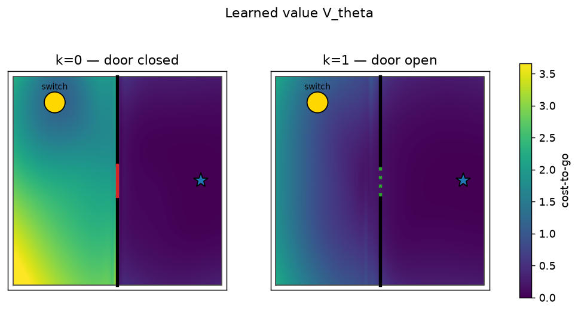
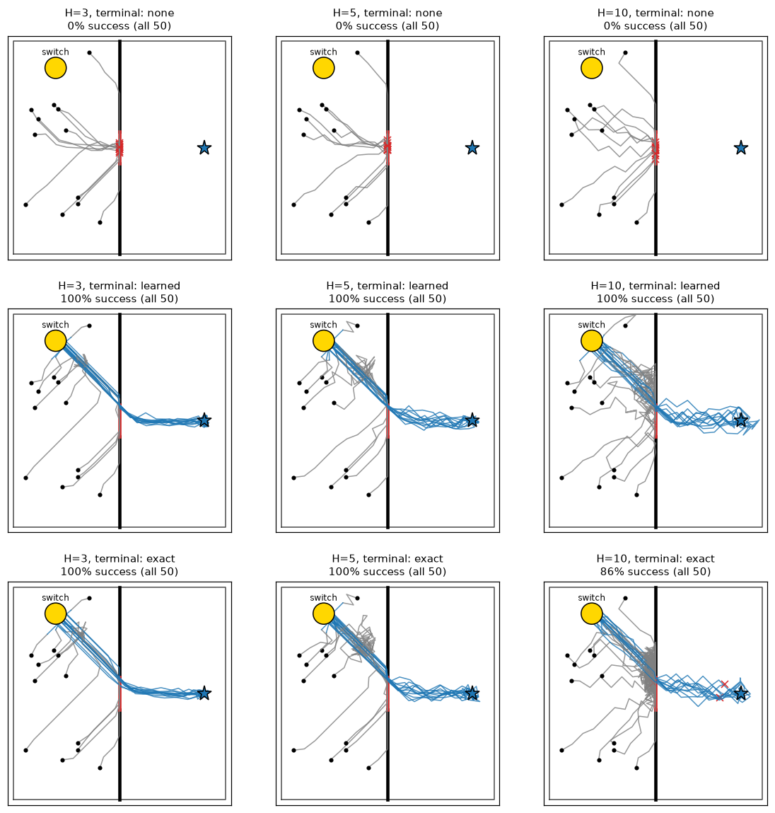

# Language to Rewards with a Learned Value Function

ROB-GY 6323 project: short-horizon MPC for multi-stage manipulation.

* An LLM writes the parameters ψ of an L2R-style reward.
* A sampling MPC optimises that reward.
* A learned terminal value V_θ(x; ψ) lets the MPC solve multi-stage tasks with a short horizon.

This repository contains the toy problem (key and door) and the shared code that the arm tasks will build on.

## What has been done

* **Reward API** in the style of Language to Rewards. A reward is a list of named residual terms (`PositionTarget`, `Distance`, `ControlEffort`). The flat vector ψ = [weight, params] per term is both what the LLM will write and what V_θ is conditioned on.
* **Batched sampling MPC.** It solves many independent problems at once, with an optional terminal cost. It supports spline knots and two update rules: the MPPI weighted average, and best-sample (MJPC Predictive Sampling, the planner L2R uses). The same function is the real-time controller and the value-iteration target solver.
* **Key-door toy environment**, batched in PyTorch, with an **exact grid value** used as ground truth and as an "oracle" terminal cost.
* **Fitted value iteration** (eq. 2 of the proposal). Targets come from a short sampling MPC with the previous value as terminal cost. Training follows Jordana et al.: V = ½‖r_θ‖², tanh layers, and an anchor term at the goal. Two additions make it work here: on-policy states and a replay buffer (see below).
* **Evaluation:** closed-loop success, steps, cost and time per step, plus value error against the exact solution.
* **Tests:** 18 unit tests covering the reward API, MPC, environment, exact value and value iteration.

## Toy problem

| Item | Definition |
|---|---|
| Room | [-1, 1]² |
| Wall | x = 0, with a door gap \|y\| < 0.15 that stays closed until the point has touched the switch at (-0.6, 0.75) |
| State | (pₓ, p_y, k), with k = 1 once the switch has been pressed |
| Dynamics | single integrator, \|u\|∞ ≤ 1, dt = 0.1 s |
| Reward | goal distance (weight 1) + control effort (weight 0.01); **no term mentions the switch** |
| Evaluation | 50 episodes from random starts left of the wall, at most 150 steps (15 s) |
| Sampler | every controller uses 256 samples and 1 iteration per control step, σ = 1, best-sample update |

Timings are from an Apple M4 CPU with one episode at a time.

### 1. Without a value function the task needs a long horizon

The exact value (left: door closed, right: door open). With the door closed, the cost-to-go correctly falls towards the switch, and it jumps sharply across the wall.


Even an exact optimiser needs a horizon of 30 steps (3 s) when there is no terminal value. This is an exact H-step lookahead on the grid:

| horizon H | 5 | 10 | 15 | 20 | 25 | 30 | 40 | 60 |
|---|---|---|---|---|---|---|---|---|
| success | 0.00 | 0.00 | 0.12 | 0.26 | 0.48 | **1.00** | 1.00 | 1.00 |

Sampling MPC is worse still. Random samples rarely find the small switch, so long horizons barely help. The table uses random starts and random goals.

| controller | success | ms / step |
|---|---|---|
| H = 5, no terminal value | 0.00 | 0.8 |
| H = 10, no terminal value | 0.00 | 1.2 |
| H = 40 (8 knots), no terminal value | 0.04 | 4.3 |
| H = 60 (12 knots), no terminal value | 0.20 | 6.4 |
| H = 3, exact value | **1.00** | 0.6 |
| H = 5, exact value | 1.00 | 0.8 |
| H = 10, exact value | 0.72 | 1.4 |

Even with 2048 samples × 3 iterations per step (24× the compute), H = 60 only reaches 42%.


### 2. Learned value: matches the exact value in closed loop

Training settings:
* 40 rounds of value iteration with 4096 states per round.
* Targets from a 5-step sampling MPC (256 samples, 3 iterations).
* MLP with 3 × 64 tanh layers and output V = ½‖r‖², r ∈ ℝ³².
* Training takes about 2 minutes on CPU.

The goal is fixed to (0.8, 0).

**Value error** on 4000 held-out states (mean exact value 0.80):

| | all states | door closed (k = 0) | door open (k = 1) |
|---|---|---|---|
| mean absolute error | 0.083 | 0.133 | 0.030 |

**Closed loop**, 50 random starts:

| horizon | terminal value | success | steps to goal | episode cost | ms / step |
|---|---|---|---|---|---|
| 3 | none | 0.00 | – | 10.01 | 0.5 |
| 3 | **learned** | **1.00** | 23.8 | 2.27 | 0.8 |
| 3 | exact | 1.00 | 23.4 | 2.22 | 0.6 |
| 5 | none | 0.00 | – | 10.06 | 0.8 |
| 5 | **learned** | **1.00** | 29.3 | 2.87 | 1.2 |
| 5 | exact | 1.00 | 30.7 | 3.08 | 1.1 |
| 10 | none | 0.00 | – | 10.16 | 1.4 |
| 10 | **learned** | **1.00** | 39.9 | 3.53 | 2.2 |
| 10 | exact | 0.86 | 64.4 | 6.11 | 2.3 |

A 3-step MPC with the learned value solves the task. It needs about 0.8 ms per step, while a 60-step MPC without it fails 80% of the time at 6.4 ms per step.

The learned value is smoother than the grid value, which makes the 10-step sampling problem easier. That is why it beats the exact value at H = 10.

| learned value | absolute error |
|---|---|
|  |  |




### 3. What it took to make value iteration work

The plain algorithm, with states sampled uniformly, fails. After 30 rounds it reaches 4% success, and the closed-door error stays at 0.40.

**The cause.** The true value jumps across the thin wall. The only states that carry the "waiting at the closed door is expensive" signal lie in a narrow strip in front of the door, and uniform sampling almost never draws them. The network smooths the jump away, every other state bootstraps from the too-low value at the door, and the error locks in.

Capacity is not the problem: the same network fitted directly to the exact value reaches 0.10 error in 500 steps. Training longer per round also doesn't help (0.42).

Variants compared with the closed-door value error and success at H = 3 / 5 / 10 (24 episodes):

| variant | closed-door error | success |
|---|---|---|
| uniform states (plain algorithm) | 0.40 | 0.04 / 0.04 / 0.04 |
| + 4× gradient steps per round | 0.42 | 0.04 / 0.04 / 0.04 |
| + 50% states from closed-loop MPC runs with V_k | 0.09 | 0.38 / 0.50 / 0.42 |
| ... and 80 rounds | 0.11 | oscillates between 0.4 and 1.0 |
| ... with 75% on-policy states | 0.15 | 1.00 → 0.08 by round 80 |
| **+ replay buffer of on-policy states (40k)** | 0.12 | **1.00** from round 10 to 70; 0.88–0.96 at round 80 |

Two ingredients do the work:

1. **On-policy states.** Jordana et al. also add states from MPC runs. Half of each round's states come from closed-loop runs of the current controller, which pile up exactly where V_k is still wrong: in front of the door.
2. **A replay buffer** of those states, with targets recomputed each round. Without it, training oscillates: once the controller succeeds, the rollouts stop visiting the door, V forgets that region, and the controller fails again.

### 4. Other findings

* **With a good value, shorter horizons work better for sampling MPC.** Using the exact value, H = 3–5 gives 100% while H = 10 gives 72–86%. Longer sampling problems are harder to solve with the same number of samples. Value-iteration targets therefore use T = 5.
* **The best-sample update was as good as or better than the MPPI weighted average in every setting tried.** The average cancels out multimodal plans ("wait at the door" versus "detour"). Both are available via `MPPIConfig.update`.
* **The exact grid value treats the goal ball (r = 0.05) as absorbing.** On a grid the point can never sit exactly on the goal, so the undiscounted value would otherwise grow without bound. Interpolation never crosses the wall.

## Setup and reproduction

```bash
uv venv --python 3.11 .venv
uv pip install --python .venv/bin/python -e ".[dev]"
.venv/bin/python -m pytest -q
```

```bash
.venv/bin/python scripts/exact_dp_keydoor.py   # exact value + horizon study      (~5 s)
.venv/bin/python scripts/run_baselines.py      # sampling-MPC baselines          (~40 s)
.venv/bin/python scripts/train_value.py        # value iteration + evaluation   (~3 min)
```

* Settings live in `configs/keydoor.yaml`.
* Outputs go to `results/`, and the trained value to `checkpoints/value_keydoor_fixed.pt`.
* `train_value.py --eval-only` re-evaluates a saved checkpoint.

> **macOS note.** `~/Desktop` is synced by iCloud, which marks files in `.venv` as hidden. Python 3.11 then skips the editable-install `.pth` file and `import rloc` fails outside the repo root. The scripts and pytest add the repo root to `sys.path` themselves. For other entry points, run from the repo root or set `PYTHONPATH=.`.

## Layout

```
rloc/
  core/
    reward_api.py   L2R-style reward: named residual terms, psi = [w, params] per term
    mppi.py         batched sampling MPC (MPPI / predictive sampling), knots, terminal cost
    value_net.py    V(x, psi) = 1/2 ||r(x, psi)||^2, tanh MLP, fixed input normalisation
    fvi.py          fitted value iteration: MPC targets, anchor, on-policy states, replay buffer
  envs/
    base.py         BatchedEnv interface (step, entity_pos, sample_states)
    keydoor2d.py    toy environment (pure torch, batched)
    keydoor2d_dp.py exact grid value iteration, oracle terminal cost
  eval/
    common.py       config loading, controller builder, batched episodes, timing
    plots.py        environment, trajectory and value heat-map plots
configs/keydoor.yaml
scripts/            exact_dp_keydoor.py, run_baselines.py, train_value.py
tests/              unit tests
results/            script outputs (only the .png figures are tracked by git)
```

An arm environment only has to implement `BatchedEnv` (wrapping `mujoco.rollout`) and `entity_pos(...)`. The reward API, MPC and value iteration are environment-agnostic.

## Not done yet

* Conditioning the value on ψ: random goals and weights, tested on held-out goals.
* A hand-written shaping baseline and a full horizon sweep.
* The Franka arm tasks, the LLM reward translator, and the comparison on LLM-written rewards.
